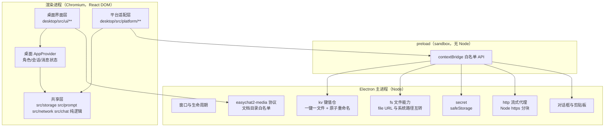
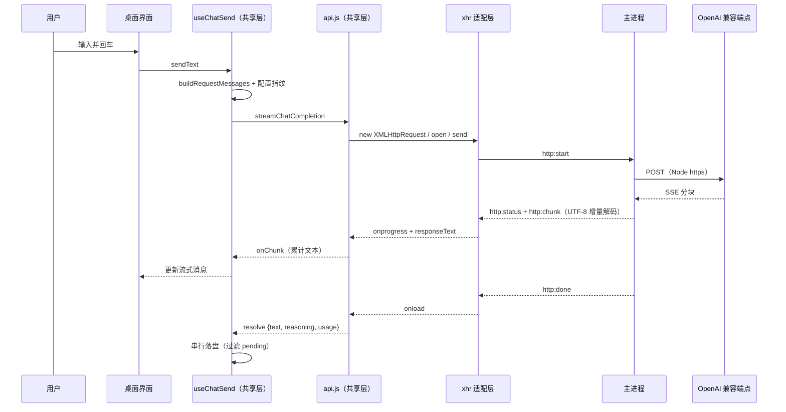

# Windows 桌面版（首版：核心聊天闭环）技术设计

Feature Name: windows-desktop
Updated: 2026-11-11
状态：待用户确认

## Description

用 Electron 承载一个全新的 React DOM 界面，复用 `src/` 中的业务逻辑、协议层、存储层与词条，把 Android 专属能力替换为 Node 侧实现。首版只交付核心聊天闭环：角色、会话、消息收发与渲染、配置、附件、导入导出、打包。

设计目标按优先级排列：

1. **逻辑单一事实源**：凡是「业务规则」都留在 `src/`，桌面端一行不复制；否则两端必然漂移。
2. **差异收敛在一层薄适配**：平台差异只在 `desktop/src/platform/**` 与 `desktop/electron/**` 出现，且每条适配都有对应契约与测试。
3. **数据可逆**：手机备份能在桌面恢复，桌面备份也能回手机，媒体路径在跨端时被显式重写。

## Architecture



- **共享层**通过构建期别名拿到适配层实现，源码零改动（见「Components and Interfaces / 别名表」）。
- **网络请求**不经过渲染进程的 `fetch`，因此不受 CORS 约束；`src/network/api.js` 的 `XMLHttpRequest` 用法由适配层实现，主子进程间用 IPC 传块。
- **媒体显示**走自定义协议，避免 `file://` 在渲染进程中的安全与路径差异。

### 聊天发送数据流



## Key Decisions

| 决策 | 选择 | 理由 |
| --- | --- | --- |
| 外壳 | Electron | 需要真实文件系统、子进程、原生对话框、系统密钥；React Native for Windows 对 RN 0.81 + 新架构 + Expo 54 支持不足，且 expo 模块几乎无 Windows 实现 |
| 界面 | 全新 React DOM | 桌面交互（宽屏双栏、快捷键、右键菜单、拖放）与移动端手势差异大；`react-native-web` 只能做「手机上放大」，无法给出合格桌面体验 |
| 共享范围 | 存储/协议/提示词/Agent/纯逻辑全复用 | 这些是 16.3 万行里真正的资产，也是两端最易漂移的部分 |
| 网络 | 主进程代发 | 渲染进程直连任意用户端点会触发 CORS 预检失败；且主进程可统一超时、证书与代理 |
| 媒体 | 自定义协议 | 渲染进程用 `file://` 需要关闭 web 安全，代价过高；自定义协议可做目录白名单校验 |
| 密钥 | safeStorage | Windows 下走 DPAPI；不可用时按既有语义降级明文并记诊断 |
| 存储 | 一键一文件 | 直接消除 Android 的 2MB 单值读限制，无需 SQLite 兜底 |
| 契约形态 | `documentDirectory` 返回 `file://` URL | 共享层全部是字符串拼接 `${documentDirectory}xxx/`，保持 URL 形态可零改动复用 |

## Components and Interfaces

### 目录结构

```
desktop/
├── package.json                 # electron / vite / react-dom / electron-builder
├── vite.config.mjs              # 别名 + JSX-in-js + 构建输出
├── electron/
│   ├── main.js                  # 应用生命周期、窗口、协议注册、CSP
│   ├── preload.js               # contextBridge 白名单（唯一通道）
│   ├── ipc/kv.js                # 键值仓
│   ├── ipc/fs.js                # 文件能力（file URL 边界）
│   ├── ipc/secret.js            # safeStorage
│   ├── ipc/http.js              # 流式 HTTP 代理
│   ├── ipc/dialog.js            # 消息框、文件选择、保存、在文件夹中显示
│   ├── ipc/media.js             # easychat2-media 协议处理
│   └── paths.js                 # 根目录解析与越界校验
├── src/
│   ├── main.jsx                 # 渲染入口
│   ├── platform/                # 适配层（共享层 import 的落点）
│   │   ├── asyncStorage.js
│   │   ├── fileSystem.js
│   │   ├── fileNext.js          # new File(uri).open()/readBytes()
│   │   ├── secureStore.js
│   │   ├── alert.js
│   │   ├── platform.js
│   │   ├── sqlite.js            # 空实现，保持惰性 require 不炸
│   │   ├── xhr.js               # XMLHttpRequest 子集 + IPC
│   │   ├── mediaUrl.js          # 本地路径 → easychat2-media URL
│   │   └── capabilities.js      # 桌面能力位（供界面禁用态）
│   ├── provider/                # DesktopAppProvider（对齐 AppContext 契约）
│   ├── ui/                      # 桌面界面（布局、聊天、角色、设置、导入导出）
│   ├── polyfills.js             # Buffer 与 TextDecoder（不直接 import src/polyfills.js）
│   └── styles/                  # 桌面样式令牌，复用 src/theme/themes.js
└── tests/                       # 桌面纯逻辑与适配层行为测试
```

`desktop/` 独立于根 `package.json`：根 `package.json` 的 `main` 仍指向 Expo 入口，Android 构建链完全不受影响。新增根脚本仅作转发：`dev:desktop`、`build:desktop`、`dist:desktop`、`test:desktop`、`lint:desktop`。

### 别名表（共享层如何拿到桌面实现）

| 共享层 import | 解析到 | 覆盖的 API |
| --- | --- | --- |
| `@react-native-async-storage/async-storage` | `platform/asyncStorage.js` | `getItem` `setItem` `removeItem` `getAllKeys` `multiGet` `multiSet` `multiRemove` |
| `expo-file-system/legacy` | `platform/fileSystem.js` | `documentDirectory` `cacheDirectory` `EncodingType` `getInfoAsync` `readAsStringAsync` `writeAsStringAsync` `makeDirectoryAsync` `readDirectoryAsync` `copyAsync` `moveAsync` `deleteAsync` `downloadAsync` `getFreeDiskStorageAsync` |
| `expo-file-system` | `platform/fileNext.js` | `File` 类（`open` `readBytes` `text` `write` `delete`） |
| `expo-secure-store` | `platform/secureStore.js` | `getItemAsync` `setItemAsync` `deleteItemAsync` `isAvailableAsync` |
| `expo-sqlite` | `platform/sqlite.js` | 恒为 `null`（大值兜底在桌面不可达） |
| `expo-device` | `platform/device.js` | 总内存读取返回系统值或 `0` |
| `expo-local-authentication` | `platform/localAuth.js` | 恒为不可用 |
| `expo-audio` `expo-speech` `expo-image-picker` `expo-document-picker` `expo-sharing` `expo-clipboard` `expo-asset` | `platform/*` 对应实现 | 见「首版能力降级」 |
| `react-native` | `platform/reactNative.js` | **只导出 `Alert`、`Platform`** |
| `buffer` | 依赖包 `buffer` | `Buffer` |

关键约束：`react-native` 别名**只导出 `Alert` 与 `Platform`**。共享层里任何模块若意外导入了 `View`/`Text`，构建期会以「未导出」失败，从而把「偷偷复用 RN 组件」这条退化路径在一开始堵死。

### 共享层复用清单

**A 级：逐字复用，无源码改动**

- `src/storage/**`（全部：io、characters、sessions、sessionMessages、sessionBranches、settings、apiConfigs、personas、backup、backupRead、dataBackup、diagnostics、secretStore、secrets、mediaProtection、streamDraft、schedule、vector、stickers、collectionStore…）
- `src/prompt/**`（chatPipeline、lorebook、regexEngine、systemSections）
- `src/network/**` 与 `src/apiProtocols/**`（协议、降级链、错误描述、超时）
- `src/i18n/index.js` 与 `src/i18n/locales/**`（纯逻辑，无 RN）
- `src/chat/` 纯逻辑：replyFlow、chatHelpers、chatMedia、assistantReply、stickerDirectives、markdownGuard、contextUsage、messageMetrics、messageSelection、richHtml、conversationExport、chatRace、toolTrace、compactionPolicy、reactiveCompact…
- `src/agent/**` 的纯部分：loop、registry、messages、permissions、resultClearing、steering、turn、planNudge
- `src/localModel/` 的纯部分：localContext、tokenEstimate、modelState、modelProfiles、engineStatus、runtime
- `src/workspace/` 的纯部分：paths、retention、store（注入 fs）、filePreview、naming、chat、capabilities、memory、skills、commands、agents、teams、hooks、sessionEvents、boardStore
- `src/character/cardParser/**`、`cardHelpers.js`、`cardExporter.js`、`characterEditGuard.js`
- `src/context/characterLibrary.js`、`sessionLibrary.js`、`pendingPayloads.js`
- `src/utils/**`、`src/logging/**`、`src/theme/themes.js`

**B 级：需要 `Alert`/`Platform`/fs 适配，源码不改**

- `src/chat/useChatSend.js`（33 处 `Alert.alert`、1 处语音 base64 读取）
- `src/chat/useSessionMessages.js`（3 处）
- `src/chat/useChatModelThinking.js`（8 处）
- `src/chat/useSessionSwitch.js`（5 处）、`useWorkspaceRewind.js`（1 处）
- `src/theme/tokens.js`（`Platform.OS` 分支，桌面走非 Android 的阴影分支）

**A-2 级：一次行为等价外提后复用**

`src/context/AppContext.js` 里唯一阻碍复用的是默认角色图片资源：

```js
// src/character/defaultCharacterAssets.js:11,18-19
import { Asset } from 'expo-asset';
const AVATAR_MODULE = require('../../assets/easychat-assistant-avatar.jpg');
```

ESM 模块里的 CommonJS `require` 在 Vite/Rollup 下不可执行，且 PNG 需要打包器处理。处理方式：把「取打包资源并落盘」抽成可注入的 `src/character/artworkLoader.js`（导出 `loadArtwork(id)`，默认实现仍走 `Asset`），`defaultCharacterAssets.js` 改为调用注入实现。桌面端注入「直接复制 `desktop/assets/**` 到 `avatars/`」的实现。

该外提是纯搬运：行为不变、新增一个文件在既有子目录内（不影响 `src/` 根文件上限），并在同一次提交里补一条行为测试（注入假 loader 断言目标路径与 `markMediaWrite` 调用）。

完成外提后 `AppContext.js` 可被桌面端逐字复用，其对外契约见 `src/context/AppContext.js:720`（角色、会话、pending 目标/引用、刷新与摄入主动消息）。桌面 Provider 只负责包一层：注入 `Alert`、注入桌面 artwork loader、补上桌面专属的 `pendingTarget` 快捷键触发。

**C 级：桌面重写**

全部 UI 组件；`src/character/defaultCharacterAssets.js` 的加载器实现；`src/screenWatch/**`、`src/music/**`、`src/books/**`、`src/chat/useChatRecorder.js`、`src/chat/useChatTts.js`、`src/localModel/adapter.js`、`src/workspace/{safStore,picker,shell,python,git}.js`（首版不注册这些能力）。

### 适配层契约

#### 1. 键值仓 `platform/asyncStorage.js`

- 目录：`<userData>/kv/`，文件名为 `sha256(key)` + `.json`，文件内容 `{ "key": "<原始键>", "value": "<原始字符串>" }`。
- 写：写 `<file>.tmp` → `fsync` → `rename` 覆盖；失败时删除临时文件并抛错。
- 读：文件不存在返回 `null`；JSON 解析失败按「读失败」抛错（由 `src/storage/io.js` 的 `readJsonStatus` 判为 corrupt）。
- `getAllKeys`：读目录并回填 `key` 字段（文件名是哈希，键名必须从内容取）。
- 不设体积上限；单值 100MB 与 2MB 走同一条路径。属性：桌面端不需要 `readLargeAsyncStorageValue`。

#### 2. 文件能力 `platform/fileSystem.js` 与 `fileNext.js`

- `documentDirectory` = `pathToFileURL(<userData>/documents/)`，**强制补结尾斜杠**；`cacheDirectory` = `pathToFileURL(<userData>/cache/)`。
- 所有入参先用 `fileURLToPath` 归一（同时接受裸绝对路径，便于导入时处理历史数据），再经 `paths.js` 校验落在 `documents/` 或 `cache/` 内；越界抛带 `code: 'PATH_OUTSIDE_ROOT'` 的错误。
- `EncodingType` 保留 `UTF8` 与 `Base64` 两个枚举值，与现有调用点一致。
- `getInfoAsync` 返回 `{ exists, uri, size, isDirectory, modificationTime }`，缺失时 `{ exists: false }`。
- `readDirectoryAsync` 返回直接子项名称数组（不含路径分隔符）。
- `new File(uri)` 契约：`open()` 返回句柄，句柄提供 `readBytes(n)`（返回 `Uint8Array`）、`offset`、`close()`；`text()` / `write(text)` / `write(base64, {encoding:'base64'})` / `delete()` 与现有调用对齐（`src/storage/backupRead.js`、`src/workspace/safStore.js` 是消费方）。
- 分片读取必须在适配层内部用 `TextDecoder(..., { stream: true })` 做增量解码；漏传 `stream: true` 会把跨片的多字节字符变成 U+FFFD（仓库已有同类教训）。

#### 3. 密钥 `platform/secureStore.js`

- 保持 `secure:v1:<id>` 引用格式（`src/storage/secretStore.js:62` 起的读写路径）。
- 写：`safeStorage.encryptString(value)` → `<userData>/secrets/<id>.bin`。
- 读：解密失败或文件缺失返回 `null`，由上层按「密钥不在」降级。
- `isAvailableAsync` 返回 `safeStorage.isEncryptionAvailable()`；为假时 `setItemAsync` 走明文实现并 `recordDiagnostic`，与既有降级语义一致。

#### 4. 网络 `platform/xhr.js`

`src/network/api.js` 只用到 XHR 的以下子集（逐项核对过）：`open`、`setRequestHeader`、`send`、`abort`、`status`、`responseText`、`onprogress`、`onload`、`onerror`、`onabort`。设计一个约 150 行的实现：

| 阶段 | 行为 |
| --- | --- |
| `open(method, url)` | 记录方法与 URL，不发起请求 |
| `setRequestHeader(k, v)` | 累积请求头（`api.js` 对每个头调用一次） |
| `send(body)` | 经 `http:start` 发起，拿到 `requestId` |
| `http:status` | 写入 `status`，随后才允许派发 `onprogress` |
| `http:chunk` | `buffer += chunk`，派发 `onprogress` |
| `http:done` | 派发 `onload` |
| `http:error` | 派发 `onerror` |
| `abort()` | `http:abort` → 派发 `onabort` |

`responseText` 是 getter，返回累计字符串。主进程侧：

- 用 `node:https` / `node:http`（按 URL 协议选择）发起，`res.setEncoding` 改为 `TextDecoder({ stream: true })` 手动解码，保证跨块多字节安全。
- 状态码在响应头到达时立即发 `http:status`。
- 以 `requestId` 维护活动请求表，窗口关闭或渲染进程崩溃时统一销毁。
- 单请求不设总时长上限（`api.js` 已有 30s 空闲超时与分阶段阈值），主进程只做「连接 / 首字节」两级超时兜底。

事件顺序保证：`http:status` → 若干 `http:chunk` → 恰好一次 `http:done` 或 `http:error`。IPC 使用 `webContents.send` 保证同进程内的顺序性；渲染侧用单调递增 `seq` 断言乱序并丢弃重复块。

需要主进程代发的其余调用面（图片下载、联网搜索、生图）在首版统一走同一个 `http` 通道，由渲染层用 `fetchToBuffer` 封装；这样 CORS 问题一次解决，后续接入新能力不再需要单独开口子。

#### 5. 媒体协议 `easychat2-media://`

- 注册为 `protocol.handle('easychat2-media', ...)`（生产环境 `standard: true, secure: true`）。
- URL 形态：`easychat2-media://media/chat-images/image-123.jpg`，路径部分解码后拼到 `documents/`，复用 `paths.js` 越界校验。
- 响应头带 `Cache-Control: no-cache`（媒体会被回收器删除，长缓存会导致恢复后仍显示旧图）。
- 渲染层用 `mediaUrl(uri)` 把 `file:///.../documents/chat-images/x.jpg` 转成协议 URL；数据库里仍保存原有 `file://` URI，不做格式变更。

#### 6. 对话框 `platform/alert.js`

`Alert.alert(title, message?, buttons?)` 映射为应用内模态（React 组件），Promise 化并支持 `style: 'cancel' | 'destructive'` 与点击遮罩的取消语义。选择应用内模态的原因：`Alert.alert` 在共享层被调用 80 余次，其中不少要求「按钮文案来自词条」与「回调里继续 await」，应用内模态能保持原有同步返回、异步回调节奏，也能统一主题。原生 `dialog.showMessageBox` 无法承载词条与主题。

### IPC 契约（preload 暴露面）

| 通道 | 入参 | 出参 |
| --- | --- | --- |
| `app:info` | 无 | `{ version, platform, userData, documents, cache }` |
| `kv:get` | `key` | `string \| null` |
| `kv:set` | `key, value` | `void` |
| `kv:remove` | `key` | `void` |
| `kv:keys` | 无 | `string[]` |
| `kv:multiGet` | `keys[]` | `[key, value\|null][]` |
| `kv:multiSet` | `[key, value][]` | `void` |
| `kv:multiRemove` | `keys[]` | `void` |
| `fs:stat` | `uri` | `{ exists, size, isDirectory, modificationTime }` |
| `fs:read` | `uri, encoding` | `string` |
| `fs:write` | `uri, data, encoding` | `void` |
| `fs:mkdir` | `uri, intermediates` | `void` |
| `fs:readDir` | `uri` | `string[]` |
| `fs:copy` / `fs:move` | `from, to` | `void` |
| `fs:delete` | `uri, idempotent` | `void` |
| `fs:download` | `url, to` | `{ uri, status }` |
| `fs:freeSpace` | 无 | `number` |
| `fs:openHandle` | `uri` | `handleId, size` |
| `fs:readBytes` | `handleId, length` | `Uint8Array` |
| `fs:closeHandle` | `handleId` | `void` |
| `secret:available` | 无 | `boolean` |
| `secret:set` | `id, value` | `void` |
| `secret:get` | `id` | `string \| null` |
| `secret:remove` | `id` | `void` |
| `dialog:alert` | `title, message, buttons` | `buttonIndex` |
| `dialog:open` | `filters, multi` | `{ canceled, files: [{ name, path }] }` |
| `dialog:save` | `defaultName, filters` | `{ canceled, path }` |
| `dialog:reveal` | `path` | `void` |
| `clipboard:write` | `text` | `void` |
| `http:start` | `{ method, url, headers, body }` | `requestId` |
| `http:abort` | `requestId` | `void` |
| 事件 `http:status` | `{ requestId, status }` | - |
| 事件 `http:chunk` | `{ requestId, seq, text }` | - |
| 事件 `http:done` / `http:error` / `http:abort` | `{ requestId, error? }` | - |

所有通道在主进程侧做参数类型校验；`uri`/`path` 一律过 `paths.js`。禁止把 `ipcRenderer` 整个对象暴露给渲染进程。

### 桌面界面信息架构

| 区域 | 内容 |
| --- | --- |
| 左侧栏（可折叠） | 角色列表 + 该角色会话列表 + 新建会话；顶部搜索 |
| 中间主区 | 消息列表 + 输入区；顶部当前角色/模型/会话标题与操作 |
| 右侧抽屉（按需） | 会话统计、记忆摘要、模型参数、角色详情 |
| 菜单栏 | 文件（导入角色卡/导入备份/导出备份）、编辑、视图（主题、语言、缩放）、帮助 |
| 右键菜单 | 消息（复制、重新生成、编辑、删除）、会话（置顶、克隆、删除） |

快捷键：`Ctrl+Enter` 发送、`Shift+Enter` 换行、`Ctrl+N` 新会话、`Ctrl+K` 搜索、`Ctrl+,` 设置、`Esc` 关闭当前弹层。

### 首版能力降级

| 能力 | 桌面首版 | 界面表现 |
| --- | --- | --- |
| 语音录制/播放/TTS | 不可用 | 按钮禁用 + 说明气泡 |
| 本地模型 | 不可用 | 模型选择器只列在线配置 |
| 工作区工具/shell/python | 不注册 | 聊天设置里工作区模式固定「询问」 |
| GitHub / MCP | 不注册 | 设置页对应卡片显示「桌面版暂不支持」 |
| 看屏幕 | 不可用 | 扩展入口显示说明 |
| 主动消息/定时任务 | 不可用 | 不启动调度器 |
| 应用锁生物识别 | 回退密码或关闭 | 设置项标注 |
| 向量记忆 | 不启用 | 开关禁用 |
| 生图 | 不接入 | 入口说明 |

降级判定的唯一来源是 `desktop/src/platform/capabilities.js`，界面只读它，避免各处散落 `process.platform` 判断。

## Data Models

### 存储

键名、值结构、迁移路径与 Android 完全一致，沿用 `src/storage/**` 的既有定义。桌面新增键：

| 键 | 值 |
| --- | --- |
| `@easychat2_desktop_window` | `{ width, height, x, y, maximized }` |
| `@easychat2_desktop_prefs` | `{ sidebarWidth, sidebarCollapsed, lastSection }` |

这两个键不进备份白名单（桌面偏好对手机无意义），也不参与 `dataBackup.js` 的 `isRawTextKey` 判定。

### 媒体 URI

- 落库形态：`file:///C:/Users/<user>/AppData/Roaming/EasyChat2/documents/chat-images/x.jpg`。
- 跨端恢复时按「已知媒体目录名」重写：`chat-images`、`chat-videos`、`voice`、`stickers`、`avatars`、`characters`、`forge`、`music`、`books`（与 `src/storage/dataBackup.js:53` 的 `BACKUP_MEDIA_DIRECTORIES` 同源）。
- 重写规则：取 URI 中最后一个匹配 `<dir>/<file>` 的片段，拼到当前 `documentDirectory` 上；匹配不到则保留原值并把该条消息标记为「媒体缺失」（渲染占位，不阻断）。

### 备份包

完全沿用 `schemaVersion: 1`。桌面实现复用 `buildBackupPayload` / `planBackupImport` / `importBackup` / `exportBackup`，只在「媒体恢复」与「媒体导出」两处注入路径重写钩子，钩子签名 `(uri) => uri`，默认实现为恒等函数（保证 Android 行为不变）。

## Correctness Properties

以下性质必须由测试钉住，任何一条被破坏都视为回归：

1. **pending 不落盘**：`buildPersistableMessages` 过滤 `pending: true`；桌面落盘路径同样经它。
2. **迟到回复丢弃**：`activeCharacterIdRef` + 会话版本不一致时，回复与错误都不写入消息列表。
3. **配置指纹**：请求发起时记录指纹，返回时不一致即丢弃并提示。
4. **串行落盘**：同一会话的保存队列严格串行；`multiSet` 不并发写同一键。
5. **键值原子性**：写入中断后文件要么是旧值、要么是新值，不存在半截 JSON。
6. **路径越界拒绝**：任何 IPC 入参解析后不在 `documents/`、`cache/`、`userData/secrets/` 内即拒绝。
7. **媒体协议白名单**：`easychat2-media://` 只解析文档目录内文件，`..` 段被拒绝。
8. **跨片多字节**：按任意字节位置切分流式响应与文件分片，解码结果与整块解码逐字相同。
9. **文档目录稳定**：应用升级、重启、语言切换后 `documentDirectory` 不变，已有 URI 继续可读。
10. **单一写者**：键值的写入只发生在主进程，渲染进程没有第二条落盘路径。

## Error Handling

| 场景 | 处理 |
| --- | --- |
| 键值文件 JSON 损坏 | 交回 `src/storage/io.js` 判 corrupt，原文件改名 `__corrupt_backup` 备份，读路径返回 fallback，界面提示可恢复 |
| 路径越界 | 抛 `PATH_OUTSIDE_ROOT`，界面提示「文件不在允许目录内」，不输出绝对路径 |
| 密钥不可用 | 明文降级 + 诊断日志，界面提示「本机密钥保护不可用」 |
| 网络连接失败 | 经既有 `describeErrorPayload` 归一，错误气泡脱敏显示，原始错误仅内存保留 |
| 用户中止请求 | 视为取消，不产生错误气泡，不写失败消息 |
| 媒体缺失 | 渲染占位，保留文本，提供「在文件夹中显示」入口 |
| 备份读取失败 | 走分片读取；仍失败则给出「文件可能损坏或被其他程序占用」的说明 |
| 磁盘空间不足 | 导出/下载前用 `getFreeDiskStorageAsync` 预检，快速失败并给出所需空间 |
| 渲染进程崩溃 | 主进程重建窗口，未落盘的流式回复通过 `@easychat2_stream_draft::<sessionId>` 恢复一次 |
| 主进程异常退出 | 键值仓为逐文件写入，不产生全局损坏；启动时清理残留 `.tmp` |

## Test Strategy

分层测试，全部可在无 Electron 窗口的环境运行：

1. **适配层行为测试**（`desktop/tests/platform/*.test.mjs`）
   - `asyncStorage`：注入临时目录，断言写入/读取/`getAllKeys`/多键操作；模拟写入中断，断言旧值仍可读。
   - `fileSystem`：`file://` 与 Windows 路径互转、越界拒绝、`readDirectoryAsync` 只返回直接子项。
   - `fileNext` 分片：构造含中文与 emoji 的 UTF-8 文件，按 1/2/3 字节错位切片，断言与整读一致。
   - `mediaUri`：跨平台路径重写表驱动用例（Android 绝对路径、Windows 路径、相对路径、未知目录）。
2. **XHR 适配层**（`desktop/tests/platform/xhr.test.mjs`）：注入假 IPC，模拟 `status` → 多块 → `done`，断言 `responseText` 累积、事件顺序、`abort` 只触发一次、乱序块被丢弃。
3. **发送编排契约测试**：`desktop/src/provider/buildChatSendProps.js` 返回的对象与 `useChatSend` 声明的入参键集合逐一比对（键名 + 非空来源），防止共享层改签名后桌面静默失效。
4. **共享层回归**：现有 `npm test` 继续全绿；新增的 `artworkLoader` 外提补一条注入式行为测试。
5. **导入导出端到端（无窗口）**：在临时目录跑「构造备份包 → 导入 → 读存储 → 断言媒体已重写 → 再导出」，用 Node 直接调用共享层。
6. **界面冒烟**：`npm run dev:desktop` 手动走 `SMOKE_TEST.md` 的聊天主路径子集；在 CI 中对 Vite 构建产物做一次加载检查（不跑真实窗口）。

覆盖率：`desktop/.c8rc.json` 只纳入 `desktop/src/platform/**`、`desktop/src/provider/**` 与 `desktop/src/ui/lib/**`，UI 展示组件排除；地板 60%，与仓库既有口径一致。Android 侧覆盖率配置不变。

## Build and CI

```
desktop/package.json
  scripts:
    dev      vite
    build    vite build
    dist     vite build && electron-builder --win nsis zip
    test     node --test tests/
```

- `electron-builder` 目标：`nsis` 与 `zip`，架构 `x64`；产物输出 `desktop/release/`。
- `vite.config.mjs` 关键配置：`resolve.alias`（上表）、`esbuild.loader['.js'] = 'jsx'`（共享层含 JSX 的 `.js` 文件）、`build.target = 'chrome126'`、`base = './'`。
- CI 新增 `.github/workflows/build-desktop-windows.yml`：`workflow_dispatch` + `push` 到 `main` 且路径命中 `desktop/**` 或 `src/**`；`runs-on: windows-latest`；步骤为安装、lint、`test:desktop`、`vite build`、`electron-builder`、上传 artifact。
- `lint` 与结构守卫扩展：`eslint` 增加 `desktop`；`no-hardcoded-chinese` 规则的 `files` 增加 `desktop/src/**`；`scripts/guard-structure.mjs` 增加 `desktop/src` 的根文件上限与行数基线（独立 `desktop/architecture-baseline.json`），Android 侧阈值不动。
- 本地开发注意：当前容器无 JDK/Android SDK，且无图形会话，因此只能验证 `vite build` 与 Node 测试；Electron 窗口验证需在 Windows 机器或带 Xvfb 的环境进行。Windows 安装包只在 Windows runner 上产出。

## Rollout

| 阶段 | 内容 | 退出条件 |
| --- | --- | --- |
| S1 | `desktop/` 骨架、IPC、适配层、`vite build` 通过 | 适配层测试全绿 |
| S2 | 复用 `src/storage/**`、i18n、theme，`AppProvider` 起步 | 角色/会话能读能写 |
| S3 | 聊天界面 + `useChatSend`/`useSessionMessages` 接线 | 流式回复可用，落盘正确 |
| S4 | 渲染（Markdown/富 HTML/媒体协议）、附件、表情包 | 走查通过 |
| S5 | 导入导出（角色卡 + 备份）+ 媒体路径重写 | 手机备份可在桌面恢复并显示图片 |
| S6 | electron-builder + Windows CI | 安装包可安装、可启动、可聊天 |

每阶段结束都要跑：`npm run lint`、`npm test`、`npm run test:desktop`、`npx vite build`（在 `desktop/` 下）。S5 完成后额外跑一次「Android 导出 → 桌面导入 → 桌面导出 → Android 导入」的往返验证。

## Risks

| 风险 | 影响 | 缓解 |
| --- | --- | --- |
| `useChatSend` 入参 40 余项，共享层改签名后桌面静默失效 | 聊天发不出去 | 键集合契约测试（Test Strategy 3）；共享层改签名必须同步该测试 |
| 共享层里散落的 `Platform.OS === 'android'` 守卫 | 功能静默关闭 | `capabilities.js` 单点声明 + 界面禁用态；五个守卫点（mcp/shell/python/proactive/screenWatch）逐个列为走查项 |
| 共享层新增依赖未加别名 | 构建失败 | 构建期报错即暴露；`vite.config.mjs` 里别名表加注释「新增共享层依赖必须在此登记」 |
| 主进程代发 HTTP 引入证书/代理差异 | 企业网络下请求失败 | 首版直接使用系统证书与系统代理（Electron 默认），错误文案保留原始原因 |
| 跨平台媒体路径重写不完整 | 恢复后图片不显示 | 表驱动测试覆盖全部媒体目录；未知目录标记媒体缺失，消息文本照常保留 |
| 富 HTML 在 iframe 中执行脚本 | 安全风险 | iframe `sandbox="allow-same-origin"` + CSP 禁外链脚本；不启用 `allow-scripts` |
| 行数棘轮与 Android 冲突 | 门禁红 | `desktop/` 使用独立基线文件；不改 `architecture-baseline.json` 的 Android 条目 |
| 未签名安装包被 SmartScreen 拦截 | 分发受阻 | 文档声明；签名证书到位后再启签名步骤 |
| 首版功能缺口被理解为「功能丢失」 | 用户困惑 | 所有未实现入口以禁用态 + 说明气泡呈现，不隐藏 |

## References

[^1]: `AGENTS.md` — 仓库约束总览（结构守卫、行数棘轮、存储键、pending 不落盘、文件系统分层、文案 i18n）
[^2]: `src/storage/io.js:90` — `readJsonStatusWithSecrets` 与键值读取入口；`:97` 的 `getSqliteModule` 是 Android 大值兜底，桌面不可达
[^3]: `src/storage/secretStore.js:62` — `getSecureStore` 与 `secure:v1:<id>` 引用格式
[^4]: `src/storage/dataBackup.js:11` — `BACKUP_SCHEMA_VERSION = 1`；`:53` `BACKUP_MEDIA_DIRECTORIES` 是媒体目录唯一权威
[^5]: `src/storage/backup.js:599` — 媒体恢复 `${documentDirectory}${item.path}`，跨平台重写钩子的落点
[^6]: `src/network/api.js:249` — `streamChatCompletion`；`:434` `new XMLHttpRequest()`；`:654` `drainIncremental`；`:681` `xhr.onprogress`
[^7]: `src/chat/useChatSend.js:183` — 发送编排入参；`:555` 起按工作区模式分流工具注册；`:1947` 返回契约
[^8]: `src/context/AppContext.js:720` — AppContext 对外值与可复用契约
[^9]: `src/character/defaultCharacterAssets.js:11` — `expo-asset` 与 `require` 静态图片，A-2 外提的动机
[^10]: `src/chat/richHtml.js:39` — 富 HTML 高度回传桥，桌面改为 iframe + `postMessage`
[^11]: `src/chat/markdownGuard.js:13` — Markdown 长度上限与截断提示
[^12]: `src/theme/tokens.js:5` — `Platform` 依赖与 `:56` 的 Android 阴影分支
[^13]: `scripts/guard-structure.mjs` — `MAX_ROOT_FILES = 31` 与行数基线协议
[^14]: `.c8rc.json` — 覆盖率纳入/排除口径与 60% 地板
[^15]: `eslint.config.mjs:58` — `no-hardcoded-chinese` 的适用文件范围
[^16]: `src/polyfills.js` — Buffer 与 `TextDecoder` 处理的既有做法（桌面端另行实现，避免复用 Expo 时期的全局摘除逻辑）
